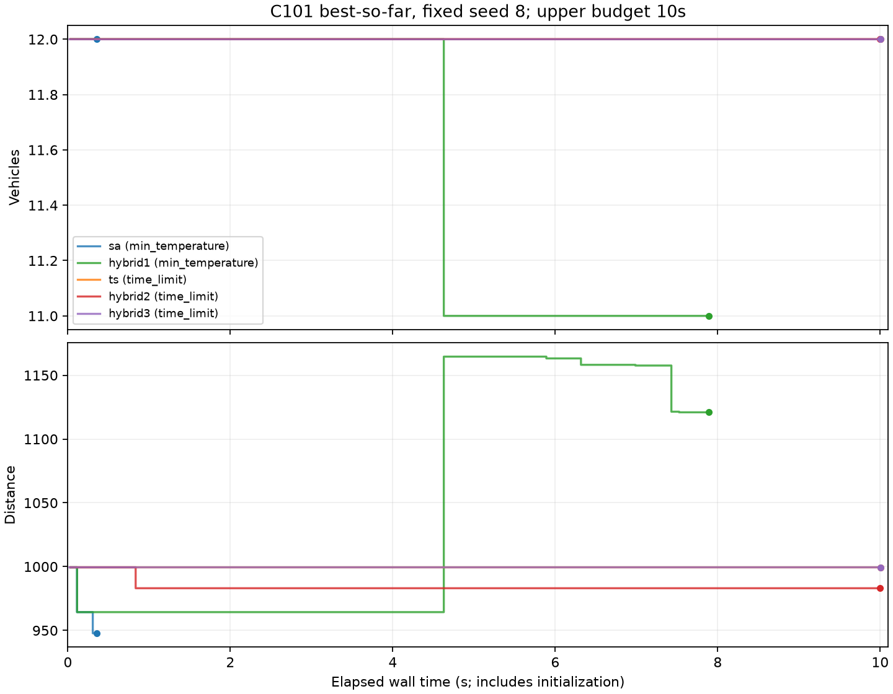

# 10 秒预算重跑结果

本轮完整运行了六实例 × 五算法 × 30 种子，共 900 次基准实验，以及 R101 九种参数或邻域设置 × 30 种子，共 270 次敏感性实验。

单次墙钟时间上限从 0.25 秒增至 10 秒，迭代上限从 1000 增至 100000；种子仍为 0～29，其余搜索参数保持原值。恢复了解析器返回、容量、客户时间窗、车场返回、客户覆盖、车辆上限、配置及输出一致性检查。新增时间戳与停止原因不改变移动选择规则。

运行采用 8 个独立进程（16 物理核心、32 逻辑处理器机器），每进程限制数值库线程为 1。预算为每次运行的墙钟上限，包含初始化；并发与系统负载可能影响实际迭代数。本轮与此前串行试跑不构成严格的硬件受控速度对照。

## 正确性与来源

修复后原有 18 项自动测试全部通过。1170 条新路线均在生成时验证，又用独立解析和约束递推全部复核；没有非法路线或距离不一致。source_before 保留修复前代码，source_used 保留实际运行版本，metadata.json 记录源文件 SHA256、环境与配置。completion.json 记录完整完成状态。

## 基准结果与旧预算对照

以下“最好”按车辆数优先、同车数再按距离选取。来自各组 30 次运行，不一定对应同一个种子。

| 实例 | 算法 | 旧预算最好 车数 距离 | 新预算最好 车数 距离 | 新预算车辆数分布 | 新平均秒数 | 新平均迭代 |
|---|---|---|---|---|---:|---:|
|C101|sa|12 / 947.75|12 / 947.75|12辆 30次|0.234|570.0|
|C101|ts|12 / 964.33|12 / 964.33|12辆 30次|10.002|2601.9|
|C101|hybrid1|12 / 964.33|11 / 1120.96|11辆 1次；12辆 29次|5.874|570.0|
|C101|hybrid2|12 / 964.33|12 / 964.33|12辆 30次|10.003|2132.7|
|C101|hybrid3|12 / 964.33|12 / 964.33|12辆 30次|10.002|2663.5|
|R101|sa|23 / 1992.17|23 / 1992.17|23辆 30次|0.197|570.0|
|R101|ts|23 / 1992.44|23 / 1992.44|23辆 30次|10.002|2813.1|
|R101|hybrid1|22 / 2065.51|22 / 1819.92|22辆 8次；23辆 22次|4.847|570.0|
|R101|hybrid2|22 / 2033.09|22 / 2011.40|22辆 20次；23辆 10次|10.002|2744.9|
|R101|hybrid3|23 / 1982.63|22 / 1947.01|22辆 6次；23辆 24次|10.002|3271.9|
|RC101|sa|20 / 2149.84|20 / 2149.84|20辆 30次|0.208|570.0|
|RC101|ts|20 / 2161.33|20 / 2161.33|20辆 30次|10.002|2759.2|
|RC101|hybrid1|20 / 2139.98|18 / 1932.22|18辆 2次；19辆 8次；20辆 20次|4.750|570.0|
|RC101|hybrid2|20 / 2145.62|19 / 2063.64|19辆 18次；20辆 12次|10.002|2629.9|
|RC101|hybrid3|19 / 2095.97|19 / 2002.51|19辆 10次；20辆 20次|10.002|3094.6|
|C201|sa|3 / 680.21|3 / 668.90|3辆 30次|0.338|570.0|
|C201|ts|3 / 688.31|3 / 688.31|3辆 30次|10.003|2158.6|
|C201|hybrid1|3 / 680.21|3 / 623.57|3辆 30次|8.870|563.3|
|C201|hybrid2|3 / 680.21|3 / 650.83|3辆 30次|10.005|1052.4|
|C201|hybrid3|3 / 703.70|3 / 650.83|3辆 30次|10.004|1478.3|
|R201|sa|5 / 1716.61|5 / 1716.61|5辆 30次|0.286|570.0|
|R201|ts|5 / 1721.46|5 / 1721.46|5辆 30次|10.003|1856.4|
|R201|hybrid1|5 / 1732.52|5 / 1473.80|5辆 30次|6.593|569.8|
|R201|hybrid2|5 / 1720.84|5 / 1703.82|5辆 30次|10.004|1325.4|
|R201|hybrid3|5 / 1721.97|5 / 1654.59|5辆 30次|10.002|1681.3|
|RC201|sa|6 / 2179.15|6 / 2179.15|6辆 30次|0.268|570.0|
|RC201|ts|6 / 2322.79|6 / 2322.79|6辆 30次|10.003|1917.0|
|RC201|hybrid1|6 / 2310.32|6 / 1695.26|6辆 30次|6.048|570.0|
|RC201|hybrid2|6 / 2316.06|6 / 2012.45|6辆 30次|10.003|1533.9|
|RC201|hybrid3|6 / 2327.68|6 / 1947.95|6辆 30次|10.003|1882.8|

## 本轮主要观察

- C101：方案一有 1/30 次达到 11 辆，距离 1120.96；其余 29 次为 12 辆。改善尚不稳定。
- R101：方案二达到 22 辆的次数由旧预算的 2/30 增至 20/30；方案一新预算为 8/30，方案三为 6/30。
- RC101：方案一最好达到 18 辆（2/30次），其余分别为 19 辆8次、20辆20次。
- C201：方案一最好为 3 辆、623.57，指定参考值下 GAP 为 5.41%；旧轮整体最好 GAP 为 14.99%。
- 纯 TS 在六个实例上的单次最好值均未超过旧轮，不能认为仅提高预算就能解决其搜索停滞。
- 这些为完整样本的描述性对照；涉及距离的统计检验应使用同车辆数分组，不能以少车解距离变长断言退化。

## 停止原因

| 算法 | 最低温度 | 时间上限 | 迭代上限 |
|---|---:|---:|---:|
|sa|180|0|0|
|ts|0|180|0|
|hybrid1|177|3|0|
|hybrid2|0|180|0|
|hybrid3|0|180|0|

时间上限增大不会关闭温度停止。保留 T0=100、cooling=0.98、Tmin=0.001 时，纯 SA 约 570 代后停止；因此它不会自动用满 10 秒。若研究完整 10 秒内的 SA，应另开实验、改变降温计划并明确同时改变了参数，不应将其混入本次“仅提高预算”结果。

## 固定种子 8 的实际耗时曲线

采用预先固定的种子 8，避免事后挑选某算法最好的一次。每条线在实际停止时间结束，末尾圆点表示终点；没有把早停曲线伪造延长至 10 秒。历史最优水平不代表当前解没有移动。



图中若车辆数下降而距离上升，仍可能是字典序目标的严格改善：先比较车辆数，再比较同车数距离。“历史最优”保证 (车辆数,距离) 字典序不变差，并不保证单独的距离曲线一直下降。

## 统计与参数结果

同车数距离均值和样本标准差见 benchmark/distance_by_vehicles.csv；混合对基线的同种子同车数配对 t 检验见 benchmark/statistical_tests.csv。按结果车数筛选会产生选择偏差，p 值未经多重检验校正，不应把个别 p<0.05 写成普遍优势。

敏感性结果见 sensitivity/summary.csv、distance_by_vehicles.csv、parameters.png 和 neighborhoods.png；所有原始记录含完整路线、历史最优、实际时间戳与停止原因。

## 复现

在项目根目录执行；配置与源代码完全一致时可续跑，改变配置或代码时使用新输出目录。

```powershell
py -3.13 -m unittest discover -s tests -v
py -3.13 -m experiments.long_budget --seconds 10 --workers 8
```
