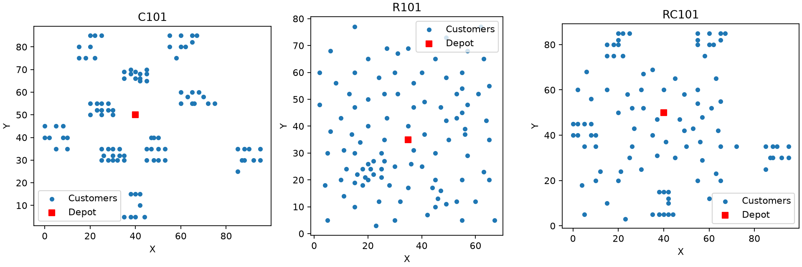

# 任务一 实例解析 可视化与正确性验证

## 当前代码与任务范围

任务一的实现集中在 `problems/vrptw.py`、`experiments/verify.py`、`visualization/distribution.py` 和 `tests/test_vrptw.py`。`main.py` 在不指定算法时调用实例分布绘图和子实例精确验证；`config/config.py` 提供数据与输出目录。项目现已实现任务二的五套搜索算法，任务三和四已有短预算试跑记录。

## 实验方法

使用 `problems/vrptw.py` 读取 Solomon 实例，得到车场、客户、车辆数上限和容量。距离与行驶时间采用欧氏距离。路径检查依次计算负载、等待后的服务开始时间和返回车场时间，并检查每个客户恰好服务一次及车辆数上限。排列按顺序依次加入当前车辆，加入后不满足约束则开启新车。

## 实例分布



红色方块为车场，蓝色圆点为客户。C101 客户较集中，R101 较分散，RC101 两种特征兼有。

## C101 前 10 客户精确验证

保留原容量、时间窗和车辆数上限，独立枚举 1023 条可行简单路径。用 PuLP/CBC 建立集合划分模型：每名客户恰由一条路径服务，先最小化车辆数，再固定最优车数最小化距离；两阶段均得到 Optimal 状态。

| 指标 | 精确模型 | 路径评价 |
|---|---:|---:|
| 车辆数 | 1 | 1 |
| 总距离 | 58.325953 | 58.325953 |
| 可行性 | 可行 | 可行 |

最优路径：`0 → 5 → 3 → 7 → 8 → 10 → 9 → 6 → 4 → 2 → 1 → 0`。独立模型计算距离与程序评价之差小于 0.000001。这个对照验证所选精确解的评价，不意味着算法框架已经完成优化求解。

## 可行性测试

`tests/test_vrptw.py` 中 8 个测试覆盖合法路径与距离、等待和车场返回时间边界、超载、客户超时、重复和缺失客户、车辆数上限、解码确定性，以及实例解析和精确路径检查。当前版本执行完整测试套件共 18 项，全部通过；PuLP 给出一条弃用提示，不影响此次测试通过。

## 初始解示例

在 C101 全部 100 个客户上，随机排列（种子 0）经解码得到 58 辆、距离 5129.73，超过 25 辆上限，因而不可行；最近可行客户贪心得到 21 辆、距离 1870.69，可行。同一实例下，插入式初始排列解码得到 12 辆、距离 999.47，也可行。当前 `SearchState` 会在插入式和最近邻产生的可行解中选择字典序较好的解作为搜索起点。

这些数字只比较了初始解，并非搜索算法的最终结果，也不能说明统计意义。任务书还要求分析不同初始解对最终解的影响；当前统一搜索接口会自动选择上述两个初始解中较好的一个，尚未提供在相同实验条件下指定随机初始解并比较最终解的流程，因此这一对照仍需补充。

## 复现

```powershell
python -m pip install -r requirements.txt
python -m unittest discover -s tests -v
python main.py
```

要求 Python 3.8 或以上，本机可将 `python` 替换为 `py -3.13`。不带算法参数运行 `main.py` 会生成 `results/distribution.png` 并输出 10 客户精确验证结果；它不会自动执行任务三、四。项目已提供五套主求解算法，PuLP 仅用于 10 客户正确性验证。
