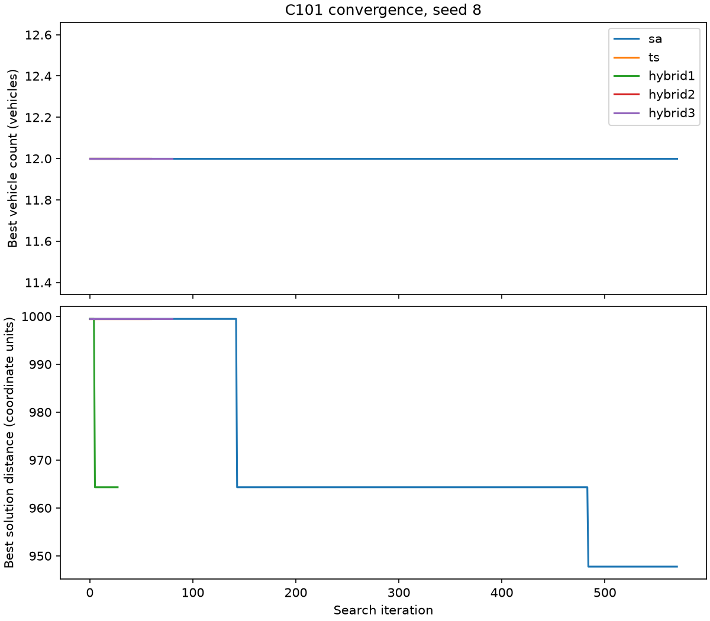
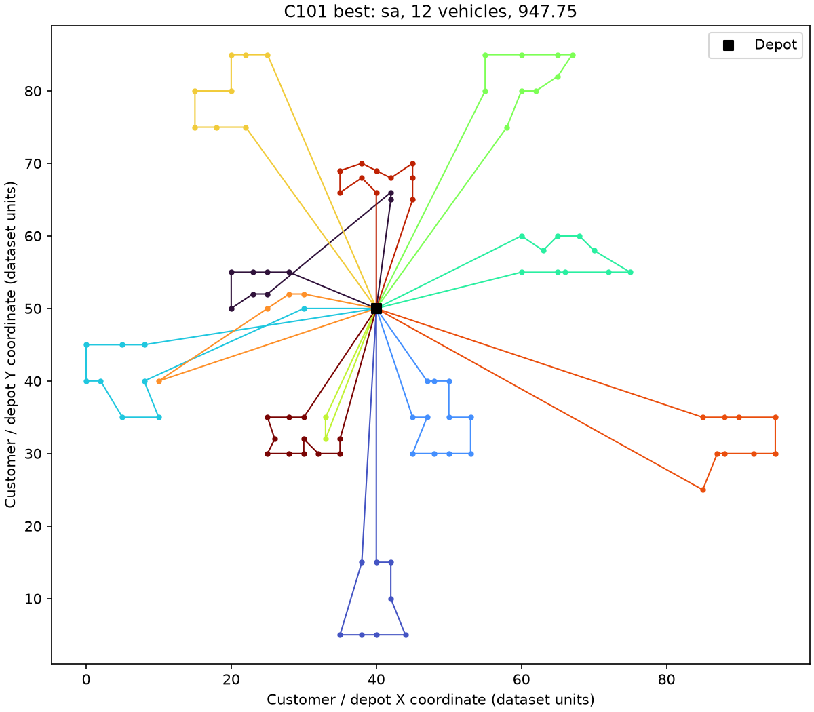

# 任务三 基准实验初步汇报

## 当前代码与记录

实验入口为 `experiments/benchmark.py`：`run_benchmark()` 按实例、算法和种子调用 `experiments/runner.py` 的统一接口，并验证返回路线。`runner.py` 的 `prepare_output()` 校验续跑配置、`append_record()` 逐条写入原始记录；`experiments/statistics.py` 负责统计，`visualization/benchmark.py` 负责收敛曲线、路径图与严格几何交叉检查。

现存试跑文件是此前生成的历史记录，并非本次重新运行的 900 次；记录没有保存代码提交哈希。现行代码经过小范围重构，固定迭代条件下 20 组路径与收敛历史对照一致，现有试跑目录的续跑配置兼容；这不能保证采用墙钟时间预算的新运行逐条重现旧结果。

## 实验范围和参数

使用 Solomon 的 C101、R101、RC101、C201、R201、RC201 六个 100 客户实例；每个实例运行纯 SA、纯 TS 和三种混合算法，各用随机种子 0～29 独立运行 30 次，共 900 次。每次最大迭代数 1000、候选数 30、时间上限 0.25 秒，其余参数见 `results/benchmark_pilot/config.json`。

已核对原始记录包含 900 条，每个“实例 × 算法”组合均有 30 条。先前版本的完整测试套件曾有 18 项全部通过。本次更新时重新运行测试为 15 项通过、1 项失败、2 项报错：当前 `SearchConfig.validate()` 已被注释，实验入口仍在调用它；需修复或调整参数校验后重新测试。此次检查没有改写这些试跑结果。

这是短预算的流程验证和初步实验，不作为充分调参后的最终性能结论。时间限制在迭代边界检查，实际运行可能略超过上限；算法还可能因温度下限等条件提前停止，实际时间和迭代数见汇总表。启用墙钟时间限制后，机器负载会影响完成的迭代次数，固定随机种子也不保证逐次完全复现。

## 结果文件

- [运行汇总](results/benchmark_pilot/summary.csv)：每组次数、最优车数与距离、最优种子、GAP、平均耗时和车辆数分布。
- [按车辆数分组的距离均值和标准差](results/benchmark_pilot/distance_by_vehicles.csv)。
- [统计检验](results/benchmark_pilot/statistical_tests.csv)：混合算法分别对比纯 SA 和纯 TS，列出匹配组车辆数、配对数、均值差、t 值和 p 值。
- [原始记录](results/benchmark_pilot/runs.jsonl)：每次的种子、结果、路线、运行时间、迭代次数和收敛历史。
- [收敛曲线](results/benchmark_pilot/convergence.png)：C101 最优结果所属种子的各算法历史最优；距离可能在车辆数减少时增加。
- [最优路径](results/benchmark_pilot/best_route.png)：C101 在所有运行中按车辆数优先选出的最优路径。

## 评价与统计口径

车辆数优先、同车数再比较距离。GAP 公式为 `(结果距离 − 参考距离) / 参考距离 × 100%`，仅当结果车辆数与参考车辆数相同、且实例为完整 100 客户时填写。参考值使用作业文档及项目数据说明中的表格，并非本实验重新证明的最优值；正式提交前应核对该表引用来源与距离精度口径。

每个实例对混合算法和两种基线按同种子配对，再仅保留两次车辆数相同的配对，并按该车辆数分别执行双侧配对 t 检验。同一种子本身并不保证不同算法经历相同随机事件，不能单凭种子相同断言配对设计消除了所有随机差异。样本不足、所有差值相同等无法计算 t 值的情况留空。按结果筛选配对会引入选择偏差；配对 t 检验还依赖差值分布假设，多个比较也未做多重检验校正。因此不能仅凭个别 p 值断言混合算法更优，应同时查看车数分布、样本量和实际差值。

## 本轮现象

### 三种混合方案的最好结果

每个实例、每种方案独立运行30次，表中为按车辆数优先选出的各自最好一次结果；单元格格式为“车辆数 / 总距离”。所有实例均为100客户，种子为0至29，每次时间上限为0.25秒、最多1000次迭代。

| 实例 | 方案一 | 方案二 | 方案三 |
|---|---:|---:|---:|
| C101 | 12 / 964.33 | 12 / 964.33 | 12 / 964.33 |
| R101 | 22 / 2065.51 | 22 / 2033.09 | 23 / 1982.63 |
| RC101 | 20 / 2139.98 | 20 / 2145.62 | 19 / 2095.97 |
| C201 | 3 / 680.21 | 3 / 680.21 | 3 / 703.70 |
| R201 | 5 / 1732.52 | 5 / 1720.84 | 5 / 1721.97 |
| RC201 | 6 / 2310.32 | 6 / 2316.06 | 6 / 2327.68 |

R101：方案二最好结果为22辆、2033.09，方案一为22辆、2065.51；方案三为23辆、1982.63。按车辆数优先，前两者的22辆结果优于该23辆结果；方案一比方案三少一辆车但距离长约82.88。方案一和方案二分别仅有1次和2次达到22辆，不能认定其稳定占优。

RC101：方案三有1次得到19辆、2095.97，另外29次为20辆；方案一和方案二30次均为20辆。C101三种方案的最好结果相同；C201方案一和方案二最好结果相同。R201和RC201三种方案的最好车数相同，分别以方案二和方案一的最好距离较短。

结果解释：表中是各组最好一次，不是平均水平，且不一定来自同一种子。各组平均耗时约0.252至0.257秒，算法可能因温度下限提前停止，时间上限仅在迭代边界检查。试跑预算较短，无法据此确认长期表现或混合增益来源；同车数均值、标准差和统计检验分别见[分车数统计表](results/benchmark_pilot/distance_by_vehicles.csv)和[统计检验表](results/benchmark_pilot/statistical_tests.csv)。


C101 所有运行均为 12 辆；最短结果为纯 SA 的 947.75。由于任务书给出的参考车数为 10 辆，距离 GAP 不具可比性，表中留空。C101 最优路径图的几何检查发现 7 处严格交叉，交叉计数不含共享端点和共线重叠；是否能够改善仍需同时检查时间窗和容量，不能仅凭平面交叉断定路径可直接优化。

C201 的最好结果为 3 辆、680.21；按任务书提供的 3 辆、591.56 参考口径，距离 GAP 约 14.99%。这些均为本次短预算结果，尚不足以判断算法长期性能或混合增益。

## 实验结果图与坐标说明

### 图 1 C101 算法收敛曲线



横轴为搜索迭代次数；上图纵轴为历史最优解使用的车辆数（辆），下图纵轴为该最优解的总距离（数据集坐标单位）。图中展示 C101 最好结果所属种子 8 的轨迹，并非 30 次平均；不同算法每次迭代的计算量可能不同。距离可能在最优车辆数减少时上升。

### 图 2 C101 最优车辆路线



横轴和纵轴分别为客户及车场在 Solomon 数据集中的 X、Y 坐标，单位沿用数据集坐标单位；黑色方块表示车场，不同颜色表示不同车辆路线。图中为纯 SA 的种子 8 结果：12 辆车、总距离约 947.75。坐标不应直接解释为公里。

## 复现和继续运行

```powershell
py -3.13 -m pip install -r requirements.txt
py -3.13 -m unittest discover -s tests -v
py -3.13 -m experiments.benchmark --out results/benchmark_pilot --repetitions 30 --seconds 0.25 --iterations 1000 --candidates 30
```

同一目录及完全相同参数可跳过已完成运行；改变时间、参数或实例时请指定新目录，例如使用 `--out results/benchmark_long --seconds 10`。正式实验建议使用更长的统一时间预算，并结合实际耗时、停止原因及统计假设复核结果。当前记录中没有逐次停止原因，报告时不能将每次运行都视为恰好用满时间预算。
